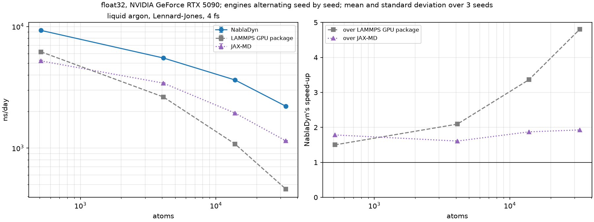
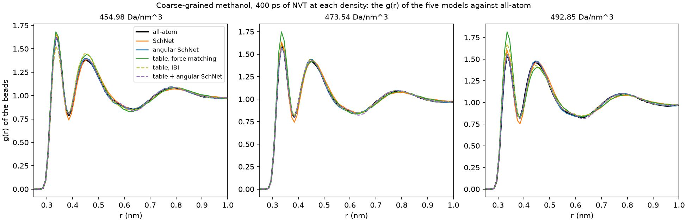
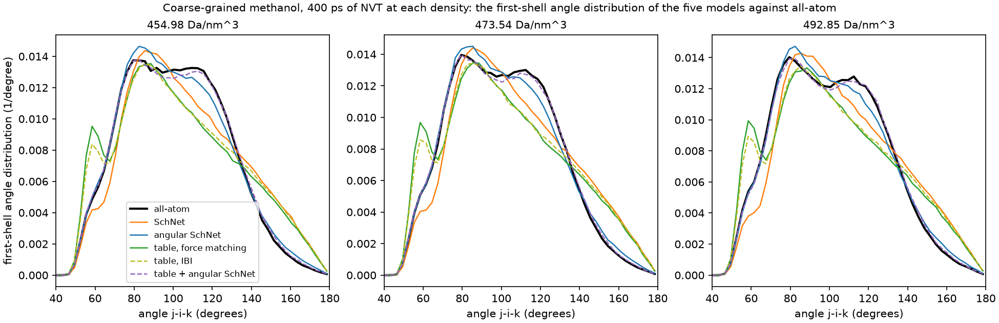
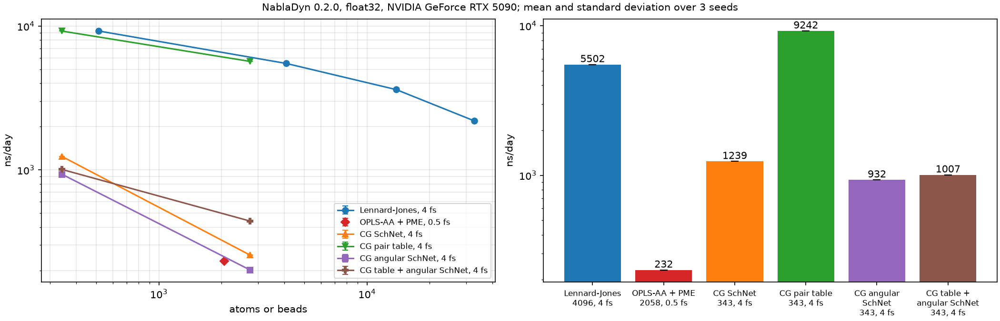

# NablaDyn

**GPU molecular dynamics and differentiable, trainable potentials in PyTorch.**

NablaDyn runs molecular dynamics on NVIDIA GPUs and trains the potentials that drive it.
Every model is a PyTorch module with one scalar energy; forces and the virial are its exact
derivatives. The neighbor list is NablaDyn's own CUDA operator, registered with PyTorch
through `torch.library`: it sorts atoms into a cell list, builds the pairs, and decides on
the GPU when they must be rebuilt. The integrator and the forces compile with
`torch.compile` ([Ansel et al., ASPLOS 2024](https://doi.org/10.1145/3620665.3640366)), and
together with the neighbor-list update each MD step is captured as a single CUDA Graph. The
same model runs in MD and trains on reference energies, forces and virials, in float32 or
float64.

- **Molecular dynamics**: NVE (velocity Verlet), NVT (Nose-Hoover chains) and isotropic NPT
  (Martyna-Tobias-Klein), periodic orthorhombic cells, HDF5 sample files.
- **Potentials**: Lennard-Jones; OPLS-AA with particle-mesh Ewald; SchNet and angular
  SchNet; tabulated pair potentials; sums of them, such as a physics prior plus a network.
- **Training**: supervised fitting of any trainable parameters to energies, forces and
  virials, with `torch.optim` optimizers (Adam, SGD, ...) and step-based schedulers.
- **GPU neighbor lists**: a CUDA cell-list operator for PyTorch; skin-based reuse is
  decided on the GPU, inside the captured step.



*Liquid argon in NVT, float32, on an RTX 5090: NablaDyn against the LAMMPS GPU package and
JAX-MD, the same model and settings in each; details under [Performance](#performance).*

## Contents

- [Installation](#installation)
- [Quick start](#quick-start)
- [Neighbor lists](#neighbor-lists)
- [Potentials](#potentials)
- [Molecular dynamics](#molecular-dynamics)
- [Training](#training)
- [Building blocks](#building-blocks)
- [Examples](#examples)
- [Performance](#performance)
- [Validation](#validation)
- [Scope and outlook](#scope-and-outlook)
- [License](#license)

## Installation

You need Linux with an NVIDIA GPU, Python 3.12 or newer, PyTorch 2.13 built with CUDA, and
the CUDA compiler `nvcc` of the same major version as PyTorch's CUDA
(`python -c "import torch; print(torch.version.cuda)"`). NablaDyn compiles its CUDA
neighbor-list operator when it is installed.

**With `nvcc` on your system** (for example `module load cuda` on a cluster):

```bash
git clone https://github.com/xxin125/NablaDyn.git
cd NablaDyn
pip install "torch==2.13.*" setuptools ninja
export CUDA_HOME=$(dirname $(dirname $(which nvcc)))
pip install --no-build-isolation ".[examples]"
```

This gives PyTorch for CUDA 13. With a CUDA 12 `nvcc`, use
`pip install "torch==2.13.*" --index-url https://download.pytorch.org/whl/cu129` instead.

**Without a CUDA toolkit**, conda installs the compiler next to Python:

```bash
conda create -y -n nabladyn -c conda-forge python=3.12 pip ninja gxx_linux-64=14 \
    cuda-version=13.0 cuda-nvcc cuda-cudart-dev cuda-cccl
conda activate nabladyn
pip install torch==2.13.0
export CUDA_HOME=$CONDA_PREFIX
pip install --no-build-isolation ".[examples]"
```

Check the installation with `python examples/lj_evaluate.py`. The `examples` extra adds
h5py (sample files) and matplotlib (figures); `samples` adds h5py alone.

If the build or the import fails:
- *CUDA version mismatch*: `nvcc --version` and `torch.version.cuda` must share the major
  version (12 or 13).
- *Building on a node without a GPU*: set the target GPUs, for example
  `export TORCH_CUDA_ARCH_LIST="8.0;9.0;12.0"` (A100, H100, RTX 5090).
- *`CXXABI_...` not found* at import: the system's C++ runtime is older than the compiler;
  `export LD_LIBRARY_PATH=$CONDA_PREFIX/lib:$LD_LIBRARY_PATH`.

## Quick start

From the `NablaDyn` folder: the energy, forces and virial of a liquid-argon frame, then
10 ps of NVT.

```python
import numpy as np
import torch
from nabladyn import md, neighbors, potential, quantity, units

device, dtype = "cuda", torch.float32
frame = np.load("examples/data/argon_512.npz")   # liquid argon, 512 atoms
positions = torch.tensor(frame["positions"], dtype=dtype, device=device)    # nm, [N, 3]
cell = torch.tensor(frame["cell"], dtype=dtype, device=device)              # nm, [3]
masses = torch.full((len(positions),), 39.948, dtype=dtype, device=device)  # Da, [N]
velocities = md.maxwell_boltzmann(masses, 120.0, seed=1)                    # nm/ps, 120 K

model = potential.lennard_jones(
    atom_types=torch.zeros(len(positions), dtype=torch.int64, device=device),
    sigma=torch.tensor([0.34], dtype=dtype, device=device),      # nm
    epsilon=torch.tensor([0.996], dtype=dtype, device=device),   # kJ/mol
    cutoff=1.0,                                                  # nm
)

# Energy, forces and virial of the frame.
neighbor_list = neighbors.NeighborList(model.cutoff)
neighbor_list.allocate(positions, cell)
evaluate = quantity.energy_force_virial(model)
energy, forces, virial = evaluate(positions, cell, neighbor_list.tensors())
print(f"Energy: {float(energy):.1f} kJ/mol")

# 10 ps of NVT at 120 K.
simulation = md.nvt(
    model,
    positions,
    velocities,
    masses,
    cell,
    timestep=0.004,            # ps
    temperature=120.0,         # K
    thermostat_timescale=0.1,  # ps
)
samples = simulation.run(2500, sample_every=100)
temperature = float(samples["temperature"].mean())        # K
pressure = float(samples["pressure"].mean()) / units.BAR  # bar
print(f"Temperature: {temperature:.1f} K, pressure: {pressure:.0f} bar")
```

Units are nm, ps, Da (g/mol), kJ/mol, K and elementary charges; `nabladyn.units` converts
(`units.BAR`, `units.ANGSTROM`, `units.KCAL_PER_MOL`, ...). Pair vectors are
$`r_{ij} = r_i - r_j`$.

## Neighbor lists

Every model takes `pairs`, the atom pairs within reach of its cutoff, from a `NeighborList`.
MD builds and updates its own list inside the captured step (see
[Molecular dynamics](#molecular-dynamics)); for single frames, analysis and your own loops,
build one yourself. The distances of the pairs within the cutoff, for the Quick start's
`positions` and `cell`:

```python
from nabladyn import neighbors, space

neighbor_list = neighbors.NeighborList(1.0, skin=0.1)   # nm, cutoff and skin
neighbor_list.allocate(positions, cell)                 # size the list and build it
pairs = neighbor_list.tensors()
i, j = pairs.index.long()           # [C] each, one pair (i, j) per column
real = i != j                       # the rest is padding: self-pairs (k, k)
r = space.displacement(positions[i[real]], positions[j[real]], cell).norm(dim=-1)
r = r[r < pairs.cutoff]             # the list also holds the pairs within the skin
```

- `NeighborList(cutoff, *, skin=0.0, capacity_multiplier=1.25, inner_cutoffs=())`:
  `allocate` sizes the list for a frame and builds it, `update` reuses it for the next
  frames until an atom has moved half the skin and then rebuilds, `tensors()` returns the
  pairs and `num_pairs` counts them. It builds on the GPU with a cell list; cells are
  orthorhombic and periodic, and positions may lie outside the cell.
- `pairs.index` is [2, C], int32, one pair (i, j) per column; `pairs.num_atoms` is N and
  `pairs.cutoff` the cutoff in nm.
- The list holds each pair once, in either orientation, for every pair closer than the
  list radius, cutoff + skin, at the last build. In the Quick start's argon frame that is
  29,014 pairs within 1.1 nm, of which 21,398 lie within the 1.0 nm cutoff. A model drops
  the pairs beyond its cutoff by their distance, so one list serves several steps.
- C is the capacity, fixed at `allocate`: `capacity_multiplier` times the first frame's
  pair count, here 1.25 x 29,014, or 36,268 once rounded up. The columns after the real
  pairs are padding, self-pairs (k, k), which a model drops by `i != j`; `num_pairs` gives
  the number of real pairs.
- The fixed shape is what lets the MD step compile once and replay as one CUDA Graph while
  the pairs change. A frame that needs more than C pairs makes `update` raise `ValueError`;
  the list then stays unusable until `allocate` sizes it again.
- `inner_cutoffs=(0.6,)`, smaller cutoffs, makes the list also keep the pairs within each,
  plus the skin, as inner lists of their own size, updated and checked with it;
  `pairs.inner` holds them, ascending. A [sum of models](#sums-of-models) gives each model
  the list at its own cutoff, and MD and training build these lists for it.

## Potentials

Each constructor in `nabladyn.potential` returns a model: `model(positions, cell, pairs)`
gives the energy in kJ/mol, with `pairs` from a neighbor list (see
[Neighbor lists](#neighbor-lists) above), and `nabladyn.quantity` gives forces and virial. A
model computes in the dtype and on the device of its parameters. [docs/api.md](docs/api.md)
gives every argument.

### Lennard-Jones

```python
model = potential.lennard_jones(
    atom_types=types,    # int64 [N], each atom's type in [0, T)
    sigma=sigma,         # nm, T(T+1)/2 values, one per type pair
    epsilon=epsilon,     # kJ/mol, likewise
    cutoff=1.0,          # nm
    trainable=("sigma", "epsilon"),   # or {"sigma": [1]} to train one row
)
```

The 12-6 potential of each pair, shifted to zero at the cutoff. `sigma` and `epsilon` hold
one value per unordered type pair in the order (0, 0), (0, 1), ..., (1, 1), ...; for two
types, `sigma=torch.tensor([s00, s01, s11])`. No mixing rule is applied.

### OPLS-AA with particle-mesh Ewald

```python
topology = potential.opls.Topology(
    charge_types=charge_types,       # int64 [N], each atom's row of parameters.charge
    lj_types=lj_types,               # int64 [N], its row of sigma and epsilon
    bonds=bonds,                     # int64 [B, 2]
    bond_types=bond_types,           # int64 [B]
    angles=angles,                   # int64 [A, 3], the vertex in the middle
    angle_types=angle_types,         # int64 [A]
    dihedrals=dihedrals,             # int64 [D, 4], propers and impropers alike
    dihedral_types=dihedral_types,   # int64 [D]
)
parameters = potential.opls.Parameters(
    charge=charge,                   # e, per charge type
    sigma=sigma,                     # nm, per LJ type
    epsilon=epsilon,                 # kJ/mol, per LJ type
    bond_r0=bond_r0,                 # nm
    bond_k=bond_k,                   # kJ/mol/nm^2
    angle_theta0=angle_theta0,       # rad
    angle_k=angle_k,                 # kJ/mol/rad^2
    dihedral_k=dihedral_k,           # kJ/mol
    dihedral_periodicity=n,          # int64, at least 1
    dihedral_phase=phase,            # rad
)
model = potential.opls(
    topology=topology,
    parameters=parameters,
    cutoff=1.0,             # nm, Lennard-Jones and real-space Coulomb
    cell=cell,              # nm, the cell the Ewald mesh is planned for
    ewald_tolerance=5e-4,
)
```

OPLS-AA ([Jorgensen et al., J. Am. Chem. Soc. 118, 11225,
1996](https://doi.org/10.1021/ja9621760)): harmonic bonds and angles, Fourier dihedrals,
geometric mixing, 1-4 pairs at half strength, and smooth particle-mesh Ewald ([Essmann et
al., J. Chem. Phys. 103, 8577, 1995](https://doi.org/10.1063/1.470117); order 5) for the
long-range Coulomb part. The mesh is planned once for `cell`: plan it for the largest cell a
run visits. The force-field parameters are fixed; an OPLS-AA model runs in MD but does not
train. [`opls_nvt.py`](examples/opls_nvt.py) builds one from a prepared methanol topology.

### SchNet

```python
model = potential.schnet(
    atom_types=types,    # int64 [N]
    num_types=1,
    cutoff=1.0,          # nm
    features=64,         # width of each atom's features
    interactions=3,      # interaction blocks
    gaussians=50,        # Gaussians of the pair distance
    trainable=True,
    seed=0,              # draws the initial weights
    dtype=torch.float32,
)
```

SchNet's continuous-filter convolutions ([Schütt et al., J. Chem. Phys. 148, 241722,
2018](https://doi.org/10.1063/1.5019779)): fixed Gaussians of the pair distance, a cosine
cutoff and shifted-softplus activations; the energy is the sum of per-atom outputs.
`model.state_dict()` holds the weights only, so they load into a model of other atoms with
the same types, sizes and cutoff, in either dtype;
[`cg_schnet_nvt.py`](examples/cg_schnet_nvt.py) loads the weights from
[`cg_schnet_fit.py`](examples/cg_schnet_fit.py).

### Angular SchNet

```python
model = potential.angular_schnet(
    atom_types=types,    # int64 [N]
    num_types=1,
    cutoff=1.0,          # nm
    channels=8,          # radial channels of the angle features
    orders=2,            # highest Legendre order of the angle features
    trainable=True,
)
```

SchNet sees only distances, so it misses how an atom's neighbors sit around it: for one-bead
coarse-grained methanol, the distribution of the angle between two neighbors of a bead. The
angular SchNet adds once, to each atom's starting features, the correlations of its neighbors'
directions: over the pairs of neighbors j, k of atom i, the Legendre polynomials
$`P_1(\cos\theta_{jik})`$ to $`P_L`$ of their angle, L = `orders`, weighted by learned radial
channels and normalized by the channels' own sums, so they need no calibration data. Orders 1
and 2 hold the angle distribution's broad shape and the orders above 2 its finer shape. They
come from sums over each atom's neighbors, never over its pairs of neighbors. It takes
`schnet`'s other arguments, with the same defaults; with its angle layers zero it is SchNet.
Alone, it has no repulsive core, since training sees no pair closer than the liquid's: at a
cutoff of 0.6 nm the methanol network learned a barrier of only about 19 to 26 kJ/mol against
two beads overlapping, and beads fused in MD; at 1.0 nm it learned about 57, as SchNet's 51,
so the examples use 1.0 nm. [`cg_angular_schnet_fit.py`](examples/cg_angular_schnet_fit.py)
trains it and [`cg_angular_schnet_nvt.py`](examples/cg_angular_schnet_nvt.py) runs it.

### Tabulated pair potential

```python
model = potential.tabulated(
    atom_types=types,          # int64 [N]
    table=table,               # kJ/mol [P, K], P type pairs, K knots, last column 0
    start=start,               # nm [P], each row's first knot
    cutoff=1.0,                # nm, each row's last knot
    trainable=("table",),
)
```

u(r) at K evenly spaced knots per type pair, joined by C1 cubic (Catmull-Rom) segments and
zero at the cutoff; below its first knot a row continues along its tangent, so start each
row where the data still resolve the repulsive wall. The table trains with `fit` like any
parameter, as in [`cg_table_fit.py`](examples/cg_table_fit.py), or is refined outside the
library, for example by Iterative Boltzmann Inversion ([Reith et al., J. Comput. Chem. 24,
1624, 2003](https://doi.org/10.1002/jcc.10307);
[`cg_table_ibi.py`](examples/cg_table_ibi.py)).

### Sums of models

```python
prior = potential.tabulated(atom_types=types, table=table, start=start, cutoff=1.0)
network = potential.angular_schnet(
    atom_types=types,
    num_types=1,
    cutoff=0.6,
    orders=5,
    trainable=True,
)
model = potential.sum(prior, network)   # E = E_prior + E_network
```

The energies of two or more models add, $`E = \sum_k E_k`$, and with them their forces and
virials: for example a physics prior plus a network that learns what the prior misses
([Wang et al., ACS Cent. Sci. 5, 755, 2019](https://doi.org/10.1021/acscentsci.8b00913)).
The sum holds the models themselves, not copies, and each trains as it was built to:
fitting `model` above fits the network to the forces the held table misses,
$`F^* - F_{\mathrm{prior}}`$, and trains `network` in place, so `network.state_dict()`
saves it. A prior built with `trainable` trains too, and parameter groups give each model
its own learning rate. The sum's cutoff is the largest of its models'; MD and training give
each model a neighbor list at its own cutoff, so the 0.6 nm network above reads only its
own pairs, not the table's 1.0 nm ones.
[`cg_prior_angular_schnet_fit.py`](examples/cg_prior_angular_schnet_fit.py) trains it and
[`cg_prior_angular_schnet_nvt.py`](examples/cg_prior_angular_schnet_nvt.py) runs it.

## Molecular dynamics

```python
simulation = md.npt(
    model,
    positions,                   # nm [N, 3]
    velocities,                  # nm/ps [N, 3]
    masses,                      # Da [N]
    cell,                        # nm [3]
    timestep=0.004,              # ps
    temperature=300.0,           # K
    pressure=1.0 * units.BAR,    # kJ/mol/nm^3
    thermostat_timescale=0.1,    # ps
    barostat_timescale=1.0,      # ps
    skin=0.1,                    # nm, the neighbor list's margin beyond the cutoff
    capacity_multiplier=1.25,    # pair capacity over the first frame's pair count
)
simulation.run(10_000)                                     # equilibrate
samples = simulation.run(
    50_000,
    sample_every=250,
    echo=True,
    sample_file="npt.h5",
)
data, settings = md.read_sample_file("npt.h5")             # frames and panel as NumPy
state = simulation.state()                                 # the current frame, copied
```

- NVE integrates by velocity Verlet ([Swope et al., J. Chem. Phys. 76, 637,
  1982](https://doi.org/10.1063/1.442716)); NVT adds a Nose-Hoover chain ([Martyna et al.,
  J. Chem. Phys. 97, 2635, 1992](https://doi.org/10.1063/1.463940)); NPT follows the
  isotropic MTK equations ([Martyna et al., J. Chem. Phys. 101, 4177,
  1994](https://doi.org/10.1063/1.467468)) with the integrator of [Tuckerman et al., J.
  Phys. A 39, 5629, 2006](https://doi.org/10.1088/0305-4470/39/19/S18).
- `md.nve`, `md.nvt` and `md.npt` build a `Simulation`; `run` advances it. Each step
  replays one CUDA Graph: the integrator, the neighbor-list update and the forces.
- Every step, on the GPU, the neighbor list checks whether an atom has moved half the
  `skin` since the last build (scaled with the cell in NPT), and rebuilds only then. Its
  pair capacity is `capacity_multiplier` times the first frame's pair count; a run that
  needs more pairs, as when NPT compresses the box, stops with an error that says to raise
  it. Both default to the values shown.
- The panel holds `md.FIELDS` (potential, kinetic and total energy, temperature and
  pressure), plus `conserved_energy` (NVT, NPT) and `volume` (NPT); it is computed only at
  sample points.
- Sample files store each sample's positions, velocities, forces, cell and image counts,
  so `positions + images * cell` gives unwrapped positions, for example for diffusion.
- A new simulation continues a run from `state` (its positions, velocities, cell, images,
  step and thermostat or barostat state).
- The simulation reads the model's parameters in place: a parameter changed in place, as
  an optimizer changes it, acts on the next step.

## Training

```python
from nabladyn import training

# model: a model from nabladyn.potential built with trainable=...
frames = training.Dataset(
    positions,           # nm [F, N, 3]
    cells,               # nm [F, 3]
    energy=energy,       # kJ/mol [F], optional
    forces=forces,       # kJ/mol/nm [F, N, 3], optional
    virial=virial,       # kJ/mol [F, 3, 3], optional
)
optimizer = torch.optim.Adam(model.parameters(), lr=1e-3)
report = training.fit(
    model,
    frames[:800],        # indexing a Dataset returns those frames
    optimizer,
    updates=5000,
    batch_size=8,
    forces=1.0,          # the weight of each channel in the loss
    virial=1.0,
    validation=frames[800:],
    scheduler=torch.optim.lr_scheduler.StepLR(optimizer, step_size=1000, gamma=0.5),
    echo_every=500,      # print the mean loss every 500 updates
)
before, after = report.validation["forces"]   # RMS force error, kJ/mol/nm
report.loss                                   # each update's batch loss
```

- The loss sums, over the channels given a weight w,
  $`w \cdot \mathrm{mean}[((X - X^*) / s)^2]`$, where s is the RMS of the channel's
  training labels (about their mean for energies and virials). So channels in different
  units start on an equal footing, and the weights set their balance. A label without a
  weight is ignored.
- Each update takes the next batch of `batch_size` frames, shuffled each epoch;
  `scheduler`, if given, steps after each update.
- Only what the model was built to train changes: `trainable` in `lennard_jones`,
  `schnet`, `angular_schnet` and `tabulated`, down to single type-pair rows such as
  `{"sigma": [1]}`. OPLS-AA does not train, and a `sum` trains what each of its models was
  built to train.
- Parameters change in place. Calling `fit` again continues from them and from the
  optimizer's state, and a simulation of the same model runs with the new values at its
  next step.
- Examples: [`lj_fit.py`](examples/lj_fit.py) (energies, forces and virials),
  [`lj_fit_rows.py`](examples/lj_fit_rows.py) (one row), and
  [`cg_schnet_fit.py`](examples/cg_schnet_fit.py),
  [`cg_angular_schnet_fit.py`](examples/cg_angular_schnet_fit.py),
  [`cg_table_fit.py`](examples/cg_table_fit.py) and
  [`cg_prior_angular_schnet_fit.py`](examples/cg_prior_angular_schnet_fit.py) (force
  matching, the last on a held table).

## Building blocks

The pieces that MD and training use are public, for analysis and your own loops. The g(r)
of the frames in the sample file written under [Molecular dynamics](#molecular-dynamics):

```python
import torch
from nabladyn import md, neighbors, observables

device, dtype = "cuda", torch.float32
data, settings = md.read_sample_file("npt.h5")                      # NumPy arrays
edges = torch.linspace(0.0, 1.0, 101, dtype=dtype, device=device)  # nm, 100 bins
neighbor_list = neighbors.NeighborList(1.0)                         # nm, farthest pair
g = 0.0
for positions, cell in zip(data["positions"], data["cell"]):
    positions = torch.tensor(positions, dtype=dtype, device=device)
    cell = torch.tensor(cell, dtype=dtype, device=device)
    neighbor_list.allocate(positions, cell)
    g = g + observables.rdf(positions, cell, neighbor_list.tensors(), edges)
g = g / len(data["positions"])                                      # [1, bins], one channel
```

- `neighbors`: see [Neighbor lists](#neighbor-lists).
- `quantity` turns a model into a function of `(positions, cell, pairs)` that returns what
  it names: `energy_force_virial`, or only `force`, `energy_and_force`, `virial`,
  `force_virial` or `energy_virial`.
- `observables`: `kinetic_energy`, `temperature`, `pressure`, `rdf`, the g(r) of each
  type pair, and `adf`, the distribution of the angles between an atom's neighbors closer
  than `r_max`.
- `space`: periodic geometry. `wrap` maps positions into the cell and returns the lattice
  crossings; `displacement` gives minimum-image vectors.
- `units`: factors into NablaDyn's units, such as `BAR`, `ATM`, `ANGSTROM`, `FS`,
  `KCAL_PER_MOL`, `EV` and `G_PER_CM3`, and the constants `BOLTZMANN`, `COULOMB` and
  `AVOGADRO`.

A guide to the API, the functions and classes you use most: [docs/api.md](docs/api.md).

## Examples

Run them from the `NablaDyn` folder, for example `python examples/lj_nvt.py`; they need the
`examples` extra (h5py and matplotlib). Each reads prepared data from `examples/data/`,
which its docstring describes, puts its settings at the top of `main()` and prints its
results. The fits and the coarse-grained examples also draw a figure in the working
directory. [`examples/README.md`](examples/README.md) describes each one, with its results
and figure.

*Lennard-Jones argon*

| Example | What it shows |
|---|---|
| [lj_evaluate.py] | energy, forces, virial and pressure of one frame |
| [lj_nvt.py] | NVT with an echo and a sample file |
| [lj_npt.py] | NPT |
| [lj_fit.py] | fitting sigma and epsilon of two atom types to energies, forces and virials |
| [lj_fit_rows.py] | fitting one type pair's row, holding the others |

*OPLS-AA methanol*

| Example | What it shows |
|---|---|
| [opls_nvt.py] | NVT with particle-mesh Ewald |
| [opls_npt.py] | NPT at 1 bar, with the density |

*Coarse-grained methanol, one bead per molecule*

| Example | What it shows |
|---|---|
| [cg_schnet_fit.py] | SchNet by force matching at three densities; saves `cg_schnet.pt` |
| [cg_schnet_nvt.py] | runs `cg_schnet.pt` in NVT; g(r), angles and pressure |
| [cg_angular_schnet_fit.py] | angular SchNet by force matching; saves `cg_angular_schnet.pt` |
| [cg_angular_schnet_nvt.py] | runs `cg_angular_schnet.pt` in NVT; g(r), angles and pressure |
| [cg_table_fit.py] | a pair table by force matching; saves `cg_table.pt` |
| [cg_table_ibi.py] | a pair table by Iterative Boltzmann Inversion; saves `cg_table_ibi.pt` |
| [cg_table_nvt.py] | runs `cg_table.pt` or `cg_table_ibi.pt` in NVT; g(r), angles and pressure |
| [cg_prior_angular_schnet_fit.py] | angular SchNet on the held `cg_table.pt`; saves the network |
| [cg_prior_angular_schnet_nvt.py] | runs the sum in NVT; g(r), angles and pressure |

[lj_evaluate.py]: examples/lj_evaluate.py
[lj_nvt.py]: examples/lj_nvt.py
[lj_npt.py]: examples/lj_npt.py
[lj_fit.py]: examples/lj_fit.py
[lj_fit_rows.py]: examples/lj_fit_rows.py
[opls_nvt.py]: examples/opls_nvt.py
[opls_npt.py]: examples/opls_npt.py
[cg_schnet_fit.py]: examples/cg_schnet_fit.py
[cg_schnet_nvt.py]: examples/cg_schnet_nvt.py
[cg_angular_schnet_fit.py]: examples/cg_angular_schnet_fit.py
[cg_angular_schnet_nvt.py]: examples/cg_angular_schnet_nvt.py
[cg_table_fit.py]: examples/cg_table_fit.py
[cg_table_ibi.py]: examples/cg_table_ibi.py
[cg_table_nvt.py]: examples/cg_table_nvt.py
[cg_prior_angular_schnet_fit.py]: examples/cg_prior_angular_schnet_fit.py
[cg_prior_angular_schnet_nvt.py]: examples/cg_prior_angular_schnet_nvt.py

### Coarse-grained methanol

The coarse-grained examples map three all-atom NVT runs of 343 OPLS-AA methanol molecules at
298.15 K (454.98, 473.54 and 492.85 Da/nm^3; 1,000 frames each) to one bead per molecule.
The SchNet, angular SchNet, table and table + angular SchNet fits use force matching
([Izvekov and Voth, J. Phys. Chem. B 109, 2469, 2005](https://doi.org/10.1021/jp044629q);
[Noid et al., J. Chem. Phys. 128, 244114, 2008](https://doi.org/10.1063/1.2938860)), and
train on the first 800 frames of each density and validate on the rest, while Iterative
Boltzmann Inversion (IBI) fits the g(r) at 474 Da/nm^3 alone. The `_nvt` examples run each
model in NVT for 400 ps at each density and compare its g(r), its first-shell angle
distribution (the angles between two neighbors closer than the g(r)'s first minimum) and its
pressure with the all-atom ones:

| Model | g(r) | Angles | Pressure |
|---|---|---|---|
| SchNet | 0.0172 / 0.0194 / 0.0252 | 1.45 / 1.43 / 1.47 | +81 / +71 / +64 |
| angular SchNet | 0.0096 / 0.0088 / 0.0068 | 0.45 / 0.46 / 0.43 | +67 / +54 / +48 |
| pair table, force matching | 0.0226 / 0.0309 / 0.0552 | 1.81 / 1.76 / 1.72 | +66 / +42 / +18 |
| pair table, IBI at 474 | 0.0283 / 0.0076 / 0.0284 | 1.71 / 1.66 / 1.62 | +41 / +17 / -8 |
| table + angular SchNet | 0.0088 / 0.0074 / 0.0091 | 0.18 / 0.15 / 0.16 | +74 / +66 / +62 |

*At 455 / 474 / 493 Da/nm^3: the RMS deviations of the g(r) and of the first-shell angle
distribution (1e-3 per degree) from the all-atom ones, and the mean pressure minus the
all-atom one (kJ/mol/nm^3). Every model but the IBI table is fitted by force matching.*

SchNet follows the structure at all three densities more closely than a pair table fitted
to the same forces; IBI matches it closely only at the density it was fitted to. The angular
SchNet follows the g(r) more closely than SchNet and the force-matched table at every
density, and the first-shell angles about three to four times more closely than any of
them. The table + angular SchNet, a network at 0.6 nm with angle orders up to 5 on the
held force-matched table, follows the g(r) about as closely and the first-shell angles two
to three times more closely still. Force matching does not fit the pressure: every
force-matched model's is too high, SchNet's furthest off, and the IBI table comes closest.



*The five models' g(r) against the all-atom one at the three densities, from their `_nvt`
examples' 400 ps runs.*



*The five models' first-shell angle distributions against the all-atom one at the three
densities, from the same runs. Each example's own figure is in the
[examples README](examples/README.md).*

## Performance


Liquid argon in NVT on one RTX 5090, float32, in ns/day:

| Atoms | NablaDyn | LAMMPS GPU package | JAX-MD |
|---|---|---|---|
| 512 | 9,288 | 6,190 | 5,207 |
| 4,096 | 5,507 | 2,631 | 3,421 |
| 13,824 | 3,632 | 1,080 | 1,940 |
| 32,768 | 2,210 | 460 | 1,147 |

The engines ran the same system: liquid argon with a shifted 12-6 Lennard-Jones pair, a 4 fs
time step, Nose-Hoover chains of three at 120 K and a 0.1 nm skin, alternating seed by seed
in one session (a 60 s warm-up, then three seeds, each the median of three timed runs).

- **NablaDyn** 0.2.0 (torch 2.13): each step replays one captured CUDA Graph.
- **LAMMPS** ([Thompson et al., Comput. Phys. Commun. 271, 108171,
  2022](https://doi.org/10.1016/j.cpc.2021.108171); stable 22 Jul 2025, Update 5): the GPU
  package ([Brown et al., Comput. Phys. Commun. 182, 898,
  2011](https://doi.org/10.1016/j.cpc.2010.12.021)) in single precision, as one process;
  pair forces and neighbor lists run on the GPU and the integration on the host. The package
  can also share a GPU among several MPI processes, which this comparison does not use.
- **JAX-MD** ([Schoenholz and Cubuk, NeurIPS 2020](https://arxiv.org/abs/1912.04232); 0.2.29
  with jax 0.10.1): float32. Each timed run is one `jax.jit`-compiled `lax.fori_loop`, so
  XLA compiles the whole loop of steps and the host launches it once per run. The neighbor
  list holds each pair once (`OrderedSparse`) with NablaDyn's skin and capacity multiplier,
  1.25. `XLA_PYTHON_CLIENT_PREALLOCATE=false` stops JAX from reserving most of the GPU
  memory while the other engines run.

NablaDyn is faster at every size: over LAMMPS by 1.5x at 512 atoms to 4.8x at 32,768, and
over JAX-MD by 1.6x to 1.9x.



*NablaDyn's MD speed in float32 on an RTX 5090: NVT with a 0.1 nm neighbor skin, liquid
argon at 4 fs, OPLS-AA methanol with PME at 0.5 fs, and coarse-grained methanol (SchNet, a
pair table, the angular SchNet, and a table plus an angular SchNet) at 4 fs. Each point is
the mean over three velocity seeds after a 60 s warm-up, each seed the median of three timed
repeats; the error bars are the standard deviation.*

## Validation

Every physical quantity is checked against an independent implementation, with the
tolerance fixed before the check:

| What | Checked against |
|---|---|
| Neighbor lists | a brute-force pair search on every build path; reuse never misses a pair |
| Lennard-Jones | LAMMPS's `pair lj/cut` in float64 |
| OPLS-AA with PME | OpenMM, GROMACS and LAMMPS on one methanol frame; a NumPy reference |
| SchNet | an independent float64 PyTorch implementation |
| Angular SchNet | an independent float64 PyTorch implementation |
| Tabulated pair potential | a NumPy reference, for energy, forces, virial and fit gradients |
| Sums of models | each model alone on its own list; inner lists against standalone lists |
| Derivatives | forces, virials and parameter gradients against central differences |
| MD, step by step | LAMMPS's `fix nve`, `nvt` and `npt iso` in float64, to 1e-12 over 20 steps |
| MD statistics | energy conservation; the canonical and isothermal-isobaric distributions |
| Training | loss gradients against analytic derivatives and central differences |
| g(r) | a NumPy reference; an ideal gas reads 1 |
| Angle distribution | a NumPy reference; an ideal gas follows $`\sin\theta / 2`$ |

## Scope and outlook

NablaDyn covers:

- NVIDIA GPUs with CUDA; there is no CPU path.
- Periodic orthorhombic cells; NPT is isotropic.
- The five built-in potentials and sums of them; a model of your own cannot be plugged in
  yet.
- Training on energies, forces and virials. MD runs are not differentiable, so a model
  cannot yet be trained on an MD observable such as g(r).

Planned:

- In 0.3, training on MD observables, such as g(r) or the density, by differentiable
  trajectory reweighting ([Thaler and Zavadlav, Nat. Commun. 12, 6884,
  2021](https://doi.org/10.1038/s41467-021-27241-4)).
- Differentiable MD over short trajectories, by backpropagation through the steps, for
  dynamical targets such as diffusion.
- Tabulated bonded terms (bonds, angles and dihedrals) alongside the pair tables, for
  complete coarse-grained force fields.
- An equivariant machine-learning potential, beyond SchNet.

## License

MIT; see [LICENSE](LICENSE).
