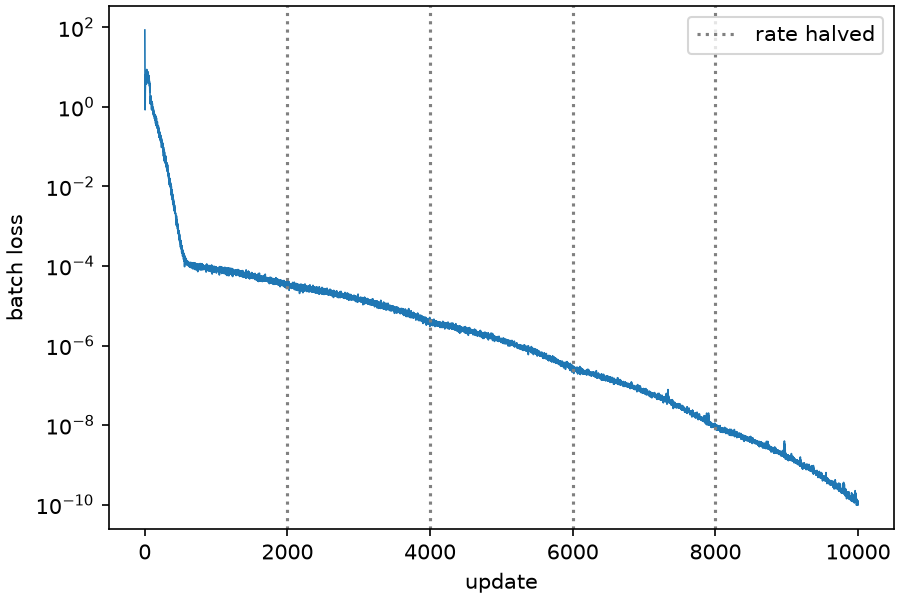
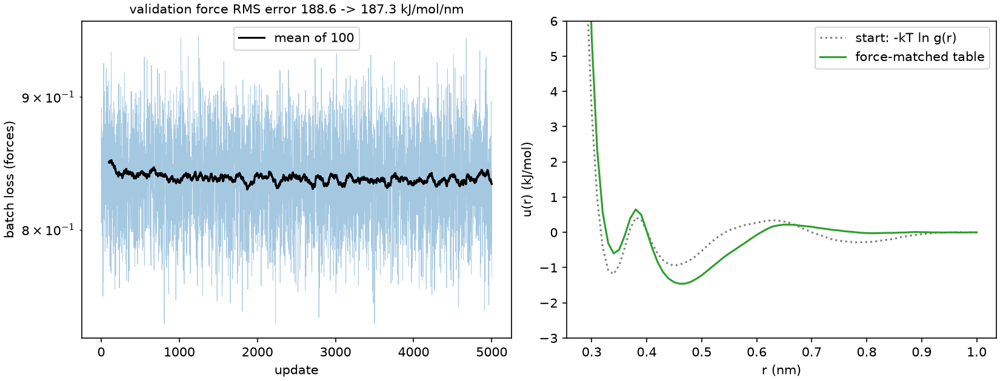
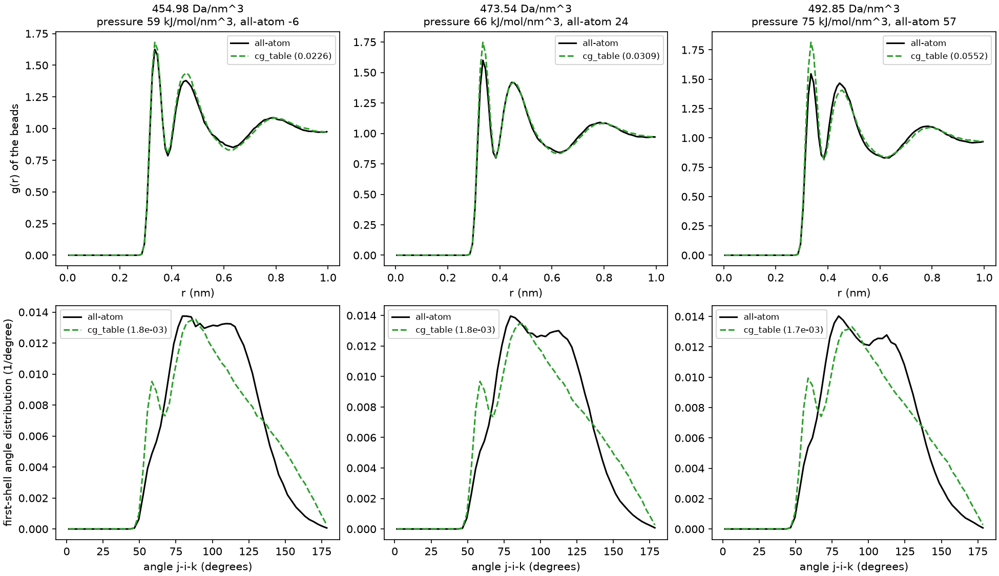
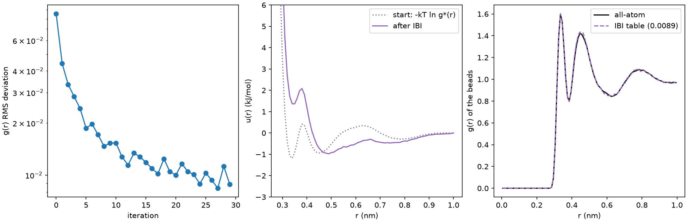
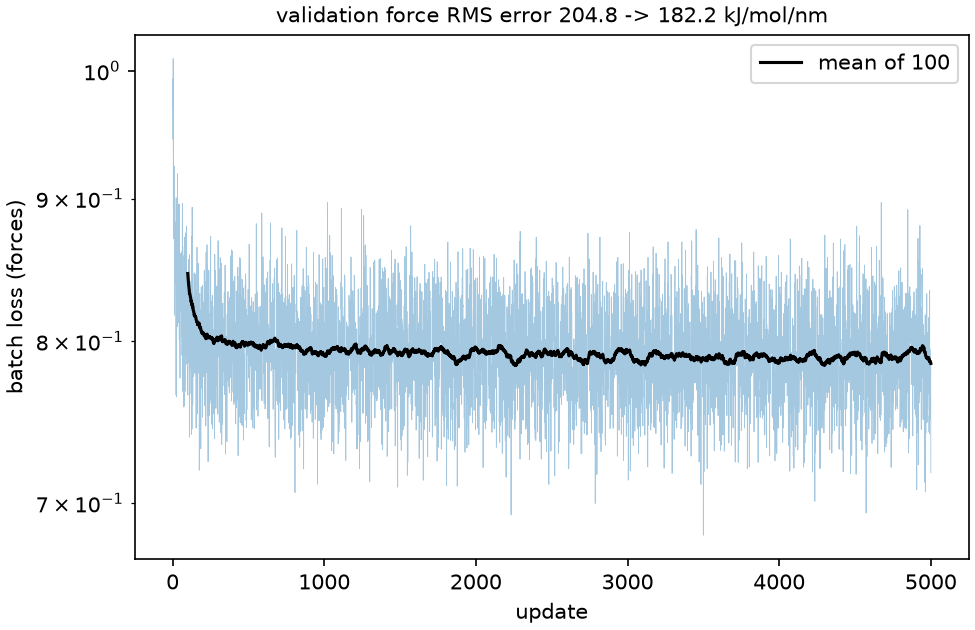
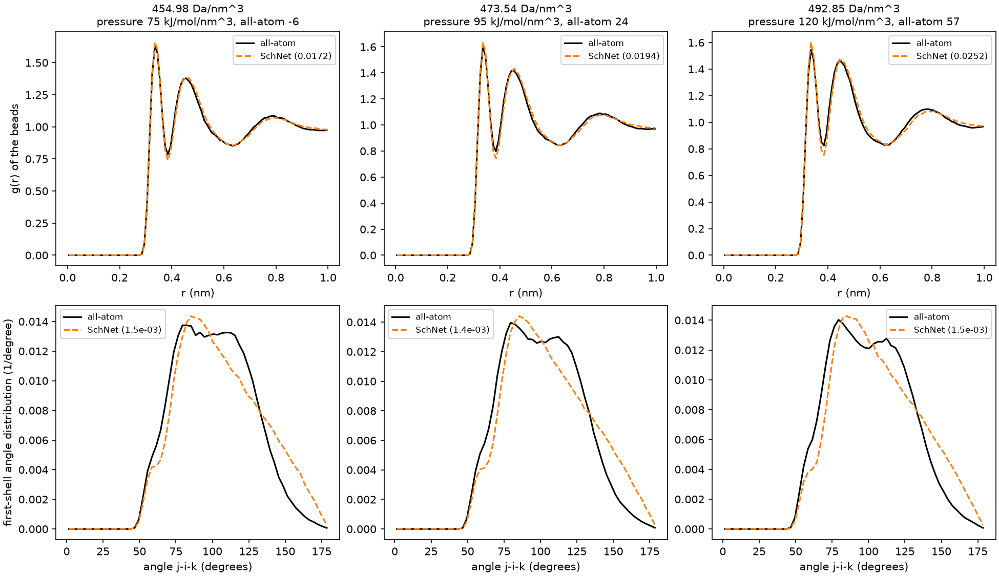
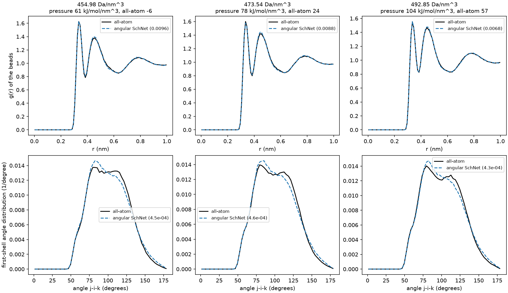
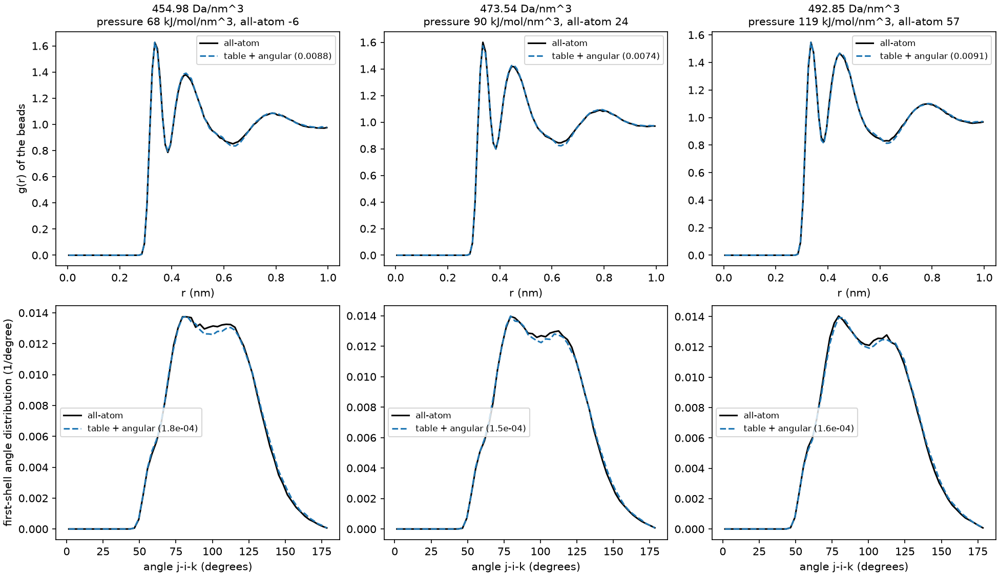

# NablaDyn examples

Each example teaches one task top to bottom. It reads prepared data from [`data/`](data),
puts its settings at the top of `main()`, prints its results and returns them, and writes
its figures, weights and sample files to the working directory. Install the `examples`
extra (h5py and matplotlib, see the [main README](../README.md#installation)) and run them
from the `NablaDyn` folder:

```bash
python examples/lj_nvt.py
```

A coarse-grained `_nvt` example loads what its fit saved, so run the fit first. The results
below come from one run of each example on an RTX 3070 Laptop GPU.

- [Data](#data)
- [Lennard-Jones argon](#lennard-jones-argon): [`lj_evaluate.py`](#lj_evaluatepy),
  [`lj_nvt.py`](#lj_nvtpy), [`lj_npt.py`](#lj_nptpy), [`lj_fit.py`](#lj_fitpy),
  [`lj_fit_rows.py`](#lj_fit_rowspy)
- [OPLS-AA methanol](#opls-aa-methanol): [`opls_nvt.py`](#opls_nvtpy),
  [`opls_npt.py`](#opls_nptpy)
- [Coarse-grained methanol](#coarse-grained-methanol): a pair table, SchNet, the angular
  SchNet and the table + angular SchNet, compared at the end

## Data

- `argon_512.npz`, for `lj_evaluate`, `lj_nvt` and `lj_npt`: 512 argon atoms equilibrated
  at $`\rho^* = 0.8`$ and $`T^* = 1.0`$ (119.8 K), with positions and cell in nm and
  velocities in nm/ps.
- `lj_frames.npz`, for `lj_fit` and `lj_fit_rows`: 300 frames of 216 atoms of two types
  with their energies, forces and virials, from a Lennard-Jones model with known rows;
  three NVT runs at 180 K in cells of 2.2, 2.8 and 3.8 nm.
- `methanol_opls.npz`, for `opls_nvt` and `opls_npt`: the frame, masses, topology and
  force-field tables of 343 methanol molecules (2,058 atoms) after 400 ps of NPT at
  298.15 K and 1 bar with OPLS-AA.
- `methanol_cg_nvt_low.npz`, `methanol_cg_nvt.npz` and `methanol_cg_nvt_high.npz`, for the
  `cg_` examples: OPLS-AA NVT of the same molecules at 298.15 K and 454.98, 473.54 (the
  experimental 0.786 g/cm^3) and 492.85 Da/nm^3, 1,000 frames 1 ps apart, mapped to one
  bead per molecule.

The coarse-grained files hold, per frame, the beads' positions (each at its molecule's
center of mass), forces (each the sum of its atoms' forces) and virials, and for the run the
bead masses, the beads' g(r) on 100 bins to 1.0 nm and the all-atom pressure with its block
error.

## Lennard-Jones argon

Argon is one atom type with $`\sigma = 0.34`$ nm and $`\varepsilon = 0.996`$ kJ/mol, shifted
to zero at a 1.0 nm cutoff, and a mass of 39.948 Da.

### lj_evaluate.py

Energy, forces, virial and pressure of one frame in float64: the model, a neighbor list with
a 0.1 nm skin, and `quantity.energy_force_virial`. It prints the pairs within the list
radius of 1.1 nm (29,014), the energy (-2,526.17 kJ/mol), the largest force (386.06
kJ/mol/nm), the virial and the pressure (745 bar).

### lj_nvt.py

10 ps of NVT at 120 K: 2,500 steps of 4 fs in float32 with a Nose-Hoover chain of time scale
0.1 ps. It prints the panel every 100 steps (time, potential, kinetic and total energy,
temperature, pressure and the conserved energy), writes the 25 samples to `lj_nvt.h5` and
reads them back with `md.read_sample_file`. Mean temperature 119.1 K, mean pressure 621 bar;
the conserved energy stays within 0.03 kJ/mol of -1,713.4 kJ/mol.

### lj_npt.py

Cools the frame to 85 K at 1 bar, where argon is a liquid: Nose-Hoover chains on the atoms
(0.1 ps) and on the isotropic barostat (1 ps), 4 fs steps in float32, 20 ps to settle and
20 ps sampled every 50 steps. Mean temperature 84.9 K, pressure 0 bar and density 1.361
g/cm^3.

### lj_fit.py

Fits sigma and epsilon of the three type-pair rows, (0,0), (0,1) and (1,1), to the energies,
forces and virials of `lj_frames.npz`, each channel with weight 1, in float64. The fit starts
10% high in sigma and 30% low in epsilon, trains on the first 80 frames of each run and
validates on the last 20: Adam at 1e-2, 10,000 updates of 48 frames, the rate halving every
2,000. Validation RMS errors before and after: energy 394.4 -> 0.0004 kJ/mol, forces
67.43 -> 0.0003 kJ/mol/nm, virial 1,165 -> 0.0006 kJ/mol; the fitted rows equal the
generating ones, (0.34, 0.32, 0.30) nm and (1.0, 0.6, 0.8) kJ/mol, to four decimals.



*`lj_fit.png`: the batch loss per update; the dotted lines mark where the rate halves.*

### lj_fit_rows.py

The same data and start, but only the cross pair's row trains, `trainable={"sigma": [1],
"epsilon": [1]}`; the rows (0,0) and (1,1) are known and held. 1,000 updates, the rate falling
to a tenth after 800. Validation RMS errors: energy 156.3 -> 0.0008 kJ/mol, forces
45.55 -> 0.00008 kJ/mol/nm, virial 458.6 -> 0.0002 kJ/mol; the row is recovered to four
decimals. It draws `lj_fit_rows.png`, the same kind of figure.

## OPLS-AA methanol

343 methanol molecules, 2,058 atoms, with OPLS-AA: harmonic bonds and angles, Fourier
dihedrals, Lennard-Jones and Coulomb with particle-mesh Ewald. Lennard-Jones and the
real-space Coulomb are shifted to zero at 1.0 nm; an Ewald tolerance of 5e-4 sets the
splitting, $`\alpha`$ = 2.6283 nm^-1, and a 24 x 24 x 24 mesh. The bonds are flexible, so the
step is 0.5 fs, in float32. A mean pressure's +- below is its standard error from 2 ps blocks.

### opls_nvt.py

10 ps of NVT at 298.15 K, the panel printed every 0.4 ps and the samples written to
`opls_nvt.h5`. Mean temperature 299.4 K. The pressure of a system this small fluctuates by
about 900 bar from sample to sample; its 10 ps mean is -540 +- 264 bar. The conserved energy
varies by 6.5 kJ/mol over the run.

### opls_npt.py

NPT at 298.15 K and 1 bar, Nose-Hoover chains on the atoms (0.1 ps) and on the isotropic
barostat (1 ps): 5 ps to settle, then 40 ps sampled every 0.4 ps and written to
`opls_npt.h5`. Mean temperature 297.1 K, pressure -218 +- 115 bar and density 0.7546 g/cm^3.

## Coarse-grained methanol

One bead per methanol molecule, from the three `methanol_cg_nvt*.npz` files. Every model is
fitted to the mapped forces (force matching: [Izvekov and Voth, J. Phys. Chem. B 109, 2469,
2005](https://doi.org/10.1021/jp044629q); [Noid et al., J. Chem. Phys. 128, 244114,
2008](https://doi.org/10.1063/1.2938860)), except the IBI table, which is fitted to the g(r).
The force fits train on the first 800 frames of each density and validate on the last 200,
in float32.

Each `_nvt` example runs its model at each density in NVT at 298.15 K: from the density
file's last frame, with velocities from seed 21, 4 fs steps and a Nose-Hoover chain of
0.1 ps, 20 ps to settle and then 400 ps sampled every 0.4 ps, long enough that the g(r)'s
sampling noise falls well below the angular SchNet's own error, as measured at
454.98 Da/nm^3. It compares with the all-atom run:
- the g(r), as the RMS deviation over its 100 bins;
- the distribution of the angle j-i-k between two neighbors j and k of a bead i, neighbors
  being closer than the all-atom g(r)'s first minimum (0.385 nm), as the RMS deviation over
  3-degree bins;
- the mean pressure, beside the all-atom one.

### Pair table: cg_table_fit.py, cg_table_nvt.py, cg_table_ibi.py

`cg_table_fit.py` fits u(r) for the bead pair at 72 knots 0.01 nm apart, from 0.29 nm, where
the data resolve the wall, to the 1.0 nm cutoff, joined by $`C^1`$ cubic segments. It starts
from $`-k_B T \ln g(r)`$ at 473.54 Da/nm^3 and trains with Adam at 1e-2, 5,000 updates of 8
frames, the rate halving every 1,000. Validation force RMS error 188.6 -> 187.3 kJ/mol/nm. It
saves `cg_table.pt`.



*`cg_table_fit.png`: the loss, and the fitted table against its Boltzmann-inversion start.*

`cg_table_nvt.py` runs a saved table, `cg_table.pt` by default; the g(r) deviates by
0.0226 / 0.0309 / 0.0552 at 455 / 474 / 493 Da/nm^3.



*`cg_table_nvt.png`: the force-matched table's g(r) (top) and first-shell angle distribution
(bottom) against the all-atom ones, with the pressures.*

`cg_table_ibi.py` fits the table to the g(r) at 473.54 Da/nm^3 alone, by Iterative Boltzmann
Inversion ([Reith et al., J. Comput. Chem. 24, 1624,
2003](https://doi.org/10.1002/jcc.10307)). It starts from $`-k_B T \ln g^*(r)`$ and makes 30
iterations, each 10 ps to settle and 50 ps sampled; each sets u(r) to
$`u(r) + k_B T \ln[g(r) / g^*(r)]`$ wherever both g(r) are at least 0.01. The last iteration's
g(r) deviates by 0.0089. It saves `cg_table_ibi.pt`. Then
`python examples/cg_table_nvt.py cg_table_ibi.pt` gives 0.0283 / 0.0076 / 0.0284 at the
three densities.



*`cg_table_ibi.png`: the g(r) deviation over the 30 iterations, the table, and the final
g(r).*

### SchNet: cg_schnet_fit.py, cg_schnet_nvt.py

SchNet at a 1.0 nm cutoff with its defaults: 64 features, 3 interactions, 50 Gaussians.
Adam at 1e-3, 5,000 updates of 8 frames, the rate halving every 1,000. Validation force RMS
error 204.8 -> 182.2 kJ/mol/nm. It saves `cg_schnet.pt`. In NVT its g(r) deviates by
0.0172 / 0.0194 / 0.0252.



*`cg_schnet_fit.png`: the batch loss and its running mean.*



*`cg_schnet_nvt.png`: the SchNet model's g(r) (top) and first-shell angle distribution
(bottom) against the all-atom ones, with the pressures.*

### Angular SchNet: cg_angular_schnet_fit.py, cg_angular_schnet_nvt.py

The angular SchNet at a 1.0 nm cutoff, with 8 radial channels for its angle features of
orders 1 and 2 and SchNet's other defaults; same protocol as SchNet. No training pair lies
closer than 0.27 nm, so the network alone has no repulsive core: at 1.0 nm it learned a
barrier of about 57 kJ/mol against two beads overlapping, as SchNet's 51, where at 0.6 nm it
learned 19 to 26 and beads fused in MD. Validation force RMS error 205.3 -> 177.7 kJ/mol/nm.
In NVT its g(r) deviates by 0.0096 / 0.0088 / 0.0068 and its first-shell angles by
0.45 / 0.46 / 0.43 x 1e-3 per degree, each the mean of the frames' `observables.adf`.



*`cg_angular_schnet_nvt.png`: g(r) (top) and the first-shell angle distribution (bottom)
against the all-atom ones, with the pressures.*

### Table + angular SchNet: cg_prior_angular_schnet_fit.py, cg_prior_angular_schnet_nvt.py

The force-matched table of `cg_table_fit.py`, held as a prior, plus an angular SchNet at
0.6 nm with angle features up to order 5 (`orders=5`) trained on top:
`potential.sum(prior, network)`, so the network fits the forces the table misses. The table
carries the attraction from 0.6 to 1.0 nm, which the network cannot see, and its wall keeps
the beads apart where the network alone at 0.6 nm let them fuse: two beads alone are
66.9 kJ/mol up at 0.20 nm. Same protocol as SchNet, training only the network, which is
saved alone as `cg_prior_angular_schnet.pt`. Validation force RMS error 188.0 -> 177.3
kJ/mol/nm.

`cg_prior_angular_schnet_nvt.py` rebuilds the sum from both files; MD gives the network its
own 0.6 nm neighbor list beside the table's 1.0 nm one, so a step costs little more than the
network's alone. Its g(r) deviates by 0.0088 / 0.0074 / 0.0091 and its first-shell
angles by 0.18 / 0.15 / 0.16 x 1e-3 per degree, the closest angles of all the models. Its
pressure is 68 / 90 / 119 kJ/mol/nm^3 against the all-atom -6 / 24 / 57: the table cuts the
error of the network alone at 0.6 nm, +129 to +131, by 43-52%, but the angular SchNet at
1.0 nm comes closer, +48 to +67.



*`cg_prior_angular_schnet_nvt.png`: g(r) (top) and the first-shell angle distribution
(bottom) against the all-atom ones, with the pressures.*

### The models compared

The same comparisons for every model at 455 / 474 / 493 Da/nm^3: the validation force RMS
error in kJ/mol/nm, the RMS deviations of the g(r) and of the first-shell angles (in 1e-3
per degree) from the all-atom ones, and the beads' mean pressure minus the all-atom one in
kJ/mol/nm^3. Every number comes from the examples' own output, the NVT ones from 400 ps at
each density. SchNet and the angular SchNet, at angle orders 2, have a 1.0 nm cutoff; the
table + angular SchNet's network has 0.6 nm and angle orders 5.

| Model | Force RMS | g(r) | Angles | Pressure |
|---|---|---|---|---|
| table, force matching | 187.3 | 0.0226 / 0.0309 / 0.0552 | 1.81 / 1.76 / 1.72 | +66 / +42 / +18 |
| table, IBI at 474 | | 0.0283 / 0.0076 / 0.0284 | 1.71 / 1.66 / 1.62 | +41 / +17 / -8 |
| SchNet | 182.2 | 0.0172 / 0.0194 / 0.0252 | 1.45 / 1.43 / 1.47 | +81 / +71 / +64 |
| angular SchNet | 177.7 | 0.0096 / 0.0088 / 0.0068 | 0.45 / 0.46 / 0.43 | +67 / +54 / +48 |
| table + angular SchNet | 177.3 | 0.0088 / 0.0074 / 0.0091 | 0.18 / 0.15 / 0.16 | +74 / +66 / +62 |

- **Structure.** SchNet follows the g(r) more closely than a pair table fitted to the same
  forces, and the two angular models more closely than both at every density. IBI, fitted to
  the g(r) at 474 Da/nm^3 alone, matches them there but not at the other two.
- **Angles.** Only the angular models get the first-shell angles, the table + angular SchNet
  at orders 5 two to three times more closely than the angular SchNet at orders 2. The others
  are three to four times further off than the angular SchNet, since a pair potential or a
  distance-only network cannot weigh where two neighbors sit around a bead.
- **Pressure.** Force matching does not fit the pressure: every force-matched model's is too
  high, by 18 to 81 kJ/mol/nm^3, SchNet's furthest off at every density. The IBI table comes
  closest at every density, 8 below all-atom at 493 Da/nm^3.
